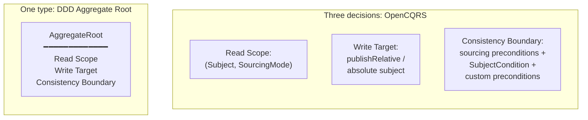
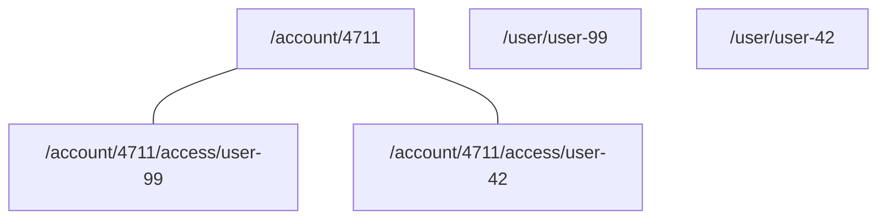
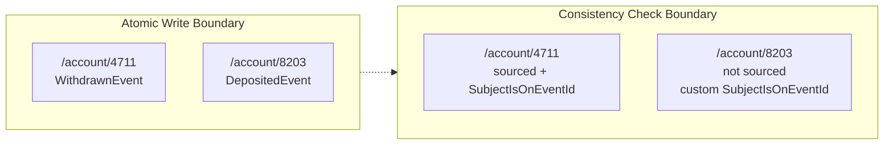
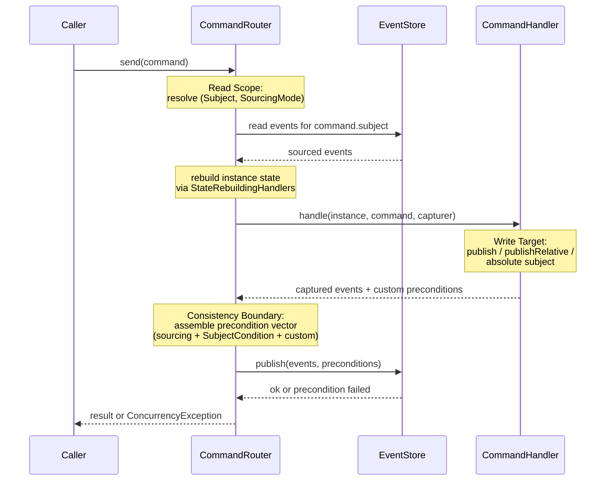

# Beyond the Aggregate Root: How OpenCQRS Decouples What the Aggregate Bundled Together

This article is about a part of OpenCQRS that took me a while to grasp, not because the mechanics are hard but because an old modeling habit was in the way. The best way in is a small example. Take a shared bank account: several users can have access to the same account, and one command grants a user that access. It is a few checks and one event, and it is the fastest way to run into a question that a Domain-Driven Design background answers for you and OpenCQRS deliberately does not.

Think about what an access grant is in that domain. It carries rights that change over time, it can be revoked, and when money goes missing you want to know who granted which rights to whom and when. A flag on the account would hold none of that. A grant has its own life and its own history.

The rule for creating one, though, does not belong to the grant. Whether user-99 may get access to account 4711 depends on the account: it has to exist, and it must not be closed. Nothing about the grant itself can answer that. The thing you check and the thing you create are two different things, and no framework is involved yet.

Now put this into OpenCQRS. Every event is stored under a subject, a path like `/account/4711`. A grant with its own history gets its own subject below the account, `/account/4711/access/user-99`, and that is where the `AccessGrantedEvent` belongs. Every command has exactly one subject as well, and before the handler runs, the framework loads the events under that subject and **[rebuilds the state](../../../../concepts/event_sourcing/index.md#reconstructing-the-write-model)** the handler decides on. So which subject should the grant command have: the one where the event ends up, or the one whose state the rules need?

If you know Domain-Driven Design, you know why this question seems to need exactly one answer. There, the Aggregate Root settles it: the events you read for a decision, the new events you write and the consistency check all belong to the same Aggregate. There is a second way to look at it, which treats those three jobs as separate decisions that only coincide in the simple case. That is the direction Dynamic Consistency Boundaries take, and it is the direction OpenCQRS takes, with subject paths instead of a query. In this article we look at what the Aggregate Root actually does, why I think the split is the better default, and how the three parts become independent dimensions that each command can shape on its own.

<!-- more -->

## What the Aggregate Was Really Doing

The Aggregate Root is a well-established pattern. Eric Evans introduced it as a central part of tactical DDD (1), and Vaughn Vernon's *Implementing Domain-Driven Design* made it the standard way to apply the pattern. Many developers learned to model a domain by drawing boundaries, picking a root and routing every command through it. The pattern works because one type owns three things at the same time.
{ .annotate }

1.  Evans introduced the Aggregate Root in *Domain-Driven Design* (Addison-Wesley, 2003), the *Blue Book*. Vernon's *Implementing Domain-Driven Design* (Addison-Wesley, 2013), the *Red Book*, is the de-facto handbook for applying the pattern in production systems.

The first is the **anchor for state reconstruction**. When a command arrives, the framework loads the events of this Aggregate, replays them through the Aggregate class and hands you the reconstructed object. Which events to load is never a question, because the type settles membership. The second is the **target identity for new events**: when the Aggregate validates a command and emits events, they are written to the Aggregate's stream, so its identity is also the address of the new events. You never pick a destination.

The third is the **consistency boundary**, and this is the one that gets the least attention. Inside the Aggregate, everything is transactionally consistent: the framework appends the new events only if nobody modified the Aggregate concurrently. Between Aggregates you have to accept eventual consistency. DDD treats the Aggregate as the unit of transactional safety, so this role is the strategic core of the pattern.

The following diagram shows the conflation. On the left, all three roles live inside one type. On the right, the same three roles as separate decisions, in the shape OpenCQRS gives them:



Because all three roles share one identity, they look like a single concept, and that is where the question comes from: you look for the one identity to attach the access grant to, because the Aggregate model says such an identity always exists. The model hides the conflation so well that you only notice it once the Aggregate is gone. The bundle is convenient exactly as long as the three coincide, and the moment they do not, the Aggregate leaves you two bad options: grow the boundary until it covers everything the command touches, or cut it and give up the atomic write. Approaches in the direction of Dynamic Consistency Boundaries make the same split. OpenCQRS gives each decision a concrete shape: a subject path and a sourcing mode for reading, a publish call for writing, and a precondition vector for the check.

## Read Scope - Where State Comes From

Without the Aggregate Root, the first role stands on its own. **[State reconstruction](../../../../reference/extension_points/state_rebuilding_handler/index.md)** in OpenCQRS is controlled by the **Read Scope**. It has two parts: the subject of the command instance and the **[`SourcingMode`](../../../../reference/extension_points/command_handler/index.md#command-handler-definitions)** of the command class. Both are values, not types, and both can differ per command type, even when two commands work on the same business object.

The subject is a hierarchical path such as `/account/4711` or `/account/4711/access/user-99`. The hierarchy has meaning for the framework: it knows that `/account/4711/access/user-99` lies below `/account/4711`. The `SourcingMode` then tells the framework how to use the subject when reading.

The examples in this article use a shared bank account domain. Each account is the root of its own subtree, with access grants below it, because a grant has its own history and its own commands: rights change, access gets revoked. You could store the grant events on the account subject instead, and the question from the introduction would never come up. The price is that every rights change sources the whole account with all its deposits to decide about one grant, and every balance projection has to skip access events. Users have a separate hierarchy, because accounts do not own users and users do not own accounts:



Accounts and users are related, but the relationship is expressed through preconditions later, not through the path. The `SourcingMode` decides how much of a hierarchy a command reads. The enum is short enough to read in full, with the Javadoc tags rendered as text:

```java
public enum SourcingMode {

    /** No events will be fetched for the Command's subject. */
    NONE,

    /** Events will be fetched for the Command's subject non-recursively. */
    LOCAL,

    /** Events will be fetched for the Command's subject recursively. */
    RECURSIVE
}
```

A `GrantAccessCommand` with subject `/account/4711` and `RECURSIVE` loads the account plus every access grant below it. The handler needs the account to check that it is still open, and it sees the existing grants, so it can tell whether the user already has access. The recursive read has a second effect that shows up later: the framework knows which grant subjects it read, and it will guard the one the handler creates. A `DepositCommand` on the same subject with `LOCAL` loads only the account-level events, so the same business object gets two different read scopes. With an Aggregate Root that was impossible, because the Aggregate itself was the unit of loading.

??? info "The defaults"

    The handlers in this article spell out their `SourcingMode`, but `@CommandHandling` defaults to `RECURSIVE`, and `Command.getSubjectCondition()` defaults to `NONE`. A handler that declares nothing therefore reads the whole subtree and lets the router guard every subject it read, while the existence of the command's own subject is never checked. Both defaults are worth setting deliberately, as the grant and the deposit do.

## Write Target - Where Events Go

The second role of the Aggregate Root is the destination for new events. In OpenCQRS the **[command handler](../../../../reference/extension_points/command_handler/index.md)** sets the destination itself. The command's subject is the default, and the handler can choose any other subject. That answers the question from the introduction: **the command's subject is the read anchor, not the identity of the thing being modified**.

The handler receives a **[`CommandEventPublisher`](../../../../reference/extension_points/command_handler/index.md#command-handlers)** to emit events. The interface offers two convenience families and one inherited fallback. `publish(event, ...)` writes the event to the command's subject. `publishRelative(subjectSuffix, event, ...)` appends a suffix to the command's subject and writes the event there. The inherited `publish(subject, event, ...)` takes any absolute subject.

```java
public interface CommandEventPublisher<I> extends EventPublisher {

    <E> I publish(E event,
                  Map<String, ?> metaData,
                  List<Precondition> preconditions);

    <E> I publishRelative(String subjectSuffix,
                          E event,
                          Map<String, ?> metaData,
                          List<Precondition> preconditions);

    // plus convenience overloads without metaData / preconditions
}
```

Back to the access grant. A `GrantAccessCommand` is dispatched with subject `/account/4711`. The handler sources the account state and the existing grants recursively, checks that the grant is allowed and writes the event below the account, to the grant's own subject. Here is the handler, still without any preconditions, which come in the next section:

```java
@CommandHandling(sourcingMode = SourcingMode.RECURSIVE)
public void grantAccess(Account account, GrantAccessCommand command,
                        CommandEventPublisher<Account> publisher) {
    if (account.isClosed()) throw new AccountClosedException();
    if (account.hasAccess(command.userId())) throw new AccessAlreadyGrantedException();

    publisher.publishRelative("access/" + command.userId(),
        new AccessGrantedEvent(command.userId(), command.rights()));
}
```

The event lands at `/account/4711/access/user-99`. The read scope is the account, the write target is a new subject below it, and two separate mechanisms decide them independently. The check in `account.hasAccess` works because `RECURSIVE` sources the grant events along with the account, so the `@StateRebuilding` handlers of the account see them. The separate subject matters as soon as the grant gets commands of its own: a `ChangeRightsCommand` on `/account/4711/access/user-99` sources that one short subject, and a concurrent deposit on the account does not invalidate it, because the deposit never touches the grant's subject (1).
{ .annotate }

1.  The checks are per exact subject. A `SubjectIsOnEventId` for `/account/4711/access/user-99` only compares that subject's latest event id, and the Javadoc of `Precondition` in the esdb-client module says the same about `SubjectIsPristine` and `SubjectIsPopulated` for events below the given subject. The grant command itself is a different case: it sources the account recursively, so it carries a check on `/account/4711`, and a concurrent deposit makes it fail.

??? tip "publishRelative is sugar"

    `publishRelative("access/user-99", event)` is a convenience method on top of `EventPublisher.publish(subject, event, ...)`, which the interface inherits from its parent. With that base method, a command handler can write to any absolute subject. Prefer `publishRelative` when the destination is a child of the command's subject, because then the call site shows the relationship. Use the absolute variant when the destination is outside the command's hierarchy, for example a system-wide audit log.

If the same handler also has to write an audit record, it uses this absolute method. The event goes to `/audit/access-changes`, completely outside the read scope of `/account/4711`. It is still part of the same atomic write batch as the access grant. The framework does not apply it to the instance either: only `publish` and `publishRelative` feed the state rebuilding handlers, while the absolute variant records the event and nothing else. So one command writes to two destinations in one atomic step.

## Consistency Boundary - What Must Not Change

The split is most visible in the third role, the consistency boundary. In the Aggregate model the type defines the boundary, and a version check on the Aggregate root enforces it. OpenCQRS has no typed root and therefore no Aggregate version. Instead, the consistency boundary is put together at runtime from three independent sources. All of them end up in a single vector of **[preconditions](../../../../reference/extension_points/command_handler/index.md)** that is attached to the atomic write.

The first source is the sourcing scope, and you get it for free. For every subject whose events the framework reads to reconstruct state, it automatically adds a **[`SubjectIsOnEventId`](https://docs.eventsourcingdb.io/fundamentals/preconditions/)** precondition to the write. The condition says: this subject must still be at the event id I saw when I read it, otherwise refuse the write. For every subject inside the sourcing scope that the handler writes to for the first time, it adds a `SubjectIsPristine` precondition: nobody may have touched this subject between my read and my write. You write no consistency code for either, and the vector covers **[what the handler read and what it wrote](../../../../reference/extension_points/command_handler/index.md#consistency-and-atomicity)**, nothing beyond that.

The second source is the command itself. `Command.SubjectCondition` is a declarative property on the command class: `NONE`, `EXISTS` or `PRISTINE`. The framework checks it before the handler runs and also adds a matching precondition to the atomic write. A `GrantAccessCommand` declares `EXISTS` on `/account/4711`, which means "refuse the command if no events have ever been recorded for this account". The framework checks this at sourcing time and enforces it as a `SubjectIsPopulated` precondition at publish time.

!!! warning "SubjectCondition with SourcingMode.NONE"

    With `NONE` the framework reads nothing, so it cannot reject the command before the handler runs. The matching precondition is still attached to the atomic write, so the store refuses the batch if the condition is violated. Your handler just cannot rely on it while deciding, and it runs once in vain. Prefer `LOCAL` or `RECURSIVE` whenever the condition matters to the handler's decision.

The third source shows the decoupling most clearly. Every captured event can carry its own preconditions through `CapturedEvent.preconditions()`. The grant handler from above can require that the user is registered, and the condition is checked atomically with the write, even though `/user/user-99` was never in the sourcing scope and the handler never read it. A typed Aggregate has no built-in way to do this. The call looks like this:

```java
publisher.publishRelative("access/" + command.userId(),
    new AccessGrantedEvent(command.userId(), command.rights()),
    Map.of(),
    List.of(new Precondition.SubjectIsPopulated("/user/" + command.userId())));
```

## One Vector, One Atomic Write

This fragment from **[`CommandRouter.send`](../../../../reference/core_components/command_router/index.md)** shows how the three sources end up in one vector. The code is simplified, but the shape is the real one. Read it top to bottom:

```java
// new subjects within sourcing scope -> SubjectIsPristine
List<Precondition> additionalPreconditions = events.stream()
        .map(CapturedEvent::subject)
        .filter(subject -> /* subject is inside sourcing scope */)
        .filter(subject -> !sourcedSubjectIds.containsKey(subject))
        .map(Precondition.SubjectIsPristine::new)
        .collect(toList());

// declarative SubjectCondition -> SubjectIsPristine or SubjectIsPopulated
switch (command.getSubjectCondition()) {
    case PRISTINE -> additionalPreconditions.add(
        new Precondition.SubjectIsPristine(command.getSubject()));
    case EXISTS   -> additionalPreconditions.add(
        new Precondition.SubjectIsPopulated(command.getSubject()));
}

// every sourced subject -> SubjectIsOnEventId at the last seen id
sourcedSubjectIds.entrySet().stream()
        .map(e -> new Precondition.SubjectIsOnEventId(e.getKey(), e.getValue()))
        .collect(toCollection(() -> additionalPreconditions));

// custom per-event preconditions
events.stream()
        .flatMap(e -> e.preconditions().stream())
        .collect(toCollection(() -> additionalPreconditions));

immediateEventPublisher.publish(events, additionalPreconditions);
```

This code has no Aggregate version and no global lock. The vector lists what must still be true at write time, collected step by step from the command and from what the handler did. For the grant, it holds four kinds of entries: `SubjectIsPopulated` for `/account/4711` from the `EXISTS` condition, `SubjectIsOnEventId` for the account and for every grant the handler read, `SubjectIsPristine` for `/account/4711/access/user-99`, and `SubjectIsPopulated` for `/user/user-99` from the handler. The framework passes the vector and the events to one atomic publish call, and the event store either accepts the whole batch or rejects it. A concurrent `CloseAccountCommand` moves the account to a new event id and the grant is refused, although the grant lives on a subject the close never touched.

So far the examples were easy. Accounts and their access grants share a subject path, and sourcing `/account/4711` recursively gives you everything you need to validate a new grant. This is also the case where DDD's Aggregate Root works well: a parent and its children with a clear boundary.

## When Subjects Don't Share a Hierarchy

A transfer between two accounts is different. `/account/4711` and `/account/8203` are siblings, neither lies below the other, and no sourcing mode reaches from one to the other. Still, both accounts' rules are evaluated in one place, the transfer handler. That is the trade: one decision, made atomically, at the price that the transfer handler has to know the target's deposit rules, like the frozen check below. The three mechanisms still help, even though the two subjects share no hierarchy.

In code, it works like this. The handler injects an **[`EventReader`](../../../../reference/core_components/event_repository/index.md)**, sources `/account/8203` with it directly, outside the framework's automatic sourcing, and rebuilds the state of the second account in memory, strongly consistent with the event store. While side-sourcing, the handler also remembers the latest event id it saw for `/account/8203`. It then checks both accounts, captures a `WithdrawnEvent` on `/account/4711` and a `DepositedEvent` on `/account/8203`, and attaches a custom precondition `SubjectIsOnEventId("/account/8203", lastSeenIdOfB)` to the deposit event. If the second account changed between the side-source and the atomic publish, the store rejects the batch and the router throws a **[`ConcurrencyException`](../../../../reference/exceptions/index.md#framework-exceptions)**.

??? info "Why not a Read Model?"

    If a decision depends on the state of `/account/8203`, sourcing its events directly from the event store gives you a strongly consistent view of the account at this moment. A **[read model](../2026-03-19-one-truth-many-views/index.md)** cannot do that. It is eventually consistent by definition, so it may lag behind, and the `SubjectIsOnEventId` precondition would only detect this at write time, not when you make the decision. A read model is fine when you only need to know whether something exists. When a business rule depends on the current value of state that another command can change, source the events.

```java
@CommandHandling(sourcingMode = SourcingMode.LOCAL)
public void transfer(Account a, TransferCommand command,
                     CommandEventPublisher<Account> publisher,
                     @Autowired EventReader eventReader) {
    // Side-source /account/B and remember its latest event id.
    AtomicReference<String> lastSeenIdOfB = new AtomicReference<>();
    Account b = sourceAccount(eventReader, command.targetSubject(), lastSeenIdOfB);
    if (b == null) throw new TargetAccountNotFoundException();

    if (a.balance().compareTo(command.amount()) < 0) throw new InsufficientFundsException();
    if (b.isFrozen()) throw new TargetFrozenException();

    publisher.publish(new WithdrawnEvent(command.amount()));
    publisher.publish(
        command.targetSubject(),
        new DepositedEvent(command.amount()),
        Map.of(),
        List.of(new Precondition.SubjectIsOnEventId(
            command.targetSubject(), lastSeenIdOfB.get())));
}
```

`LOCAL` is deliberate. The transfer needs the balance, which lives on the account subject, and sourcing recursively would pull every grant into the consistency boundary, so a concurrent rights change on some grant would make the transfer fail for no reason. Three things in this handler are up to you, because the framework cannot do them: reading `/account/B` through `EventReader` instead of `Command.getSubject()`, applying B's events to an `Account` yourself, and passing the observed event id into a `SubjectIsOnEventId` precondition on the deposit event. Everything else, including the atomic publish at the end, is the usual flow with one extra precondition. Retrying after a `ConcurrencyException` is the caller's decision, and the framework marks the exception as transient for exactly that purpose.

??? info "What sourceAccount does"

    ```java
    private Account sourceAccount(EventReader reader, String subject,
                                  AtomicReference<String> lastSeenId) {
        AtomicReference<Account> state = new AtomicReference<>();
        reader.consumeUpcasted(
            (client, consumer) -> client.read(subject, Set.of(), consumer),
            (callback, raw) -> {
                lastSeenId.set(raw.id());
                callback.convert(event -> state.set(Account.apply(state.get(), event)));
            });
        return state.get();
    }
    ```

    `Account.apply` dispatches to the same methods the `@StateRebuilding` handlers use. The router's own application logic is not public, so this dispatch is yours to write. Remembering the raw event id is the part the framework would otherwise do for you.

You could call this **transactional consistency through the back door** (1): Optimistic Concurrency Control, OCC for short, across two subjects, enforced through preconditions instead of a shared lock. You can build this with Aggregates too, but then you have to assemble the precondition plumbing by hand, outside the framework's command pattern. For cross-hierarchy cases OpenCQRS does not promise more than a classical Aggregate. It does give you the precondition vector as a built-in tool when a single command really needs to span several subjects.
{ .annotate }

1.  Shorthand for two-subject Optimistic Concurrency Control over a per-event precondition vector. The "transactional" part is the all-or-nothing semantics: the atomic publish either commits every event with all observed preconditions still intact, or it commits none. The "back door" part is that the developer assembles this vector by hand instead of getting it from a typed boundary.

When the price of knowing the target's rules grows, because they are many or belong to another team, a single handler stops being the right place. Then you are looking at coordination that cannot be reduced to one decision: several instances each have their own write-side rule, each rule can fail independently, and a failure in a later step needs explicit compensation. The usual name for the answer is a Saga, or a process manager. OpenCQRS has no type and no term for it. The samples repository calls it a Saga, so this article does too, and the box below points to a worked example.

??? info "A worked Saga example"

    The OpenCQRS samples repository includes a runnable Saga at **[opencqrs-samples/implementing-sagas](https://github.com/open-cqrs/opencqrs-samples/tree/main/implementing-sagas)**. The domain is a library lending workflow. `Reader` enforces "at most two active loans" on its own state, `Book` enforces "only one borrower at a time" on its own state, and a `Loan` instance coordinates between them. The `@EventHandling("loan")` methods, spread over `LoanHandling`, `ReaderHandling` and `BookHandling`, react to events from Reader and Book, dispatch follow-up commands through `CommandRouter` and send compensating commands (`RejectBookRequestCommand` → `RemoveLoanFromReaderCommand` → `CancellLoanCommand`) when a later step fails. The sample shows that a Saga in OpenCQRS is an ordinary instance with ordinary `@CommandHandling` and `@EventHandling` methods. Its state just happens to be a workflow.

## Write Boundary and Check Boundary

The next diagram shows a distinction that is easy to miss. The atomic write boundary, either all my events land or none do, is not the same as the consistency check boundary. An OpenCQRS command can write atomically to subjects it never sourced, and it can include subjects in the consistency check that it never writes to. Classical Aggregates treat both as one boundary:



For the transfer, both lists happen to name the same two subjects, but they were filled from different places. The withdrawal's subject entered the check list through sourcing, the deposit's subject through the precondition the handler attached by hand. The grant from earlier shows the lists diverging: `/user/user-99` is in the check list and in no write list at all, while the audit subject is in the write list and in no check list.

The introduction named **Dynamic Consistency Boundaries** (DCB), as developed by Sara Pellegrini (1), as the direction this split comes from. DCB goes one step further and defines the boundary as a predicate over events instead of a set of subject identifiers. OpenCQRS sits between the typed Aggregate and DCB: more flexible than the first, narrower than the second. The **[write model article](../2026-04-13-the-write-model/index.md)** introduces DCB in more depth.
{ .annotate }

1.  Pellegrini developed Dynamic Consistency Boundaries in conference talks and articles as a generalization of event-sourced consistency. The key change is that a consistency boundary is a predicate over events (a query), not a bounded type or a set of subject identifiers. Every event that matches the predicate is part of the boundary, no matter where it is stored. Most commands source from and write to the same subject, so the path already settles who "owns" an event. This article is about the rarer cases where reading and writing diverge. DCB is about the even rarer cases where no single owner makes sense at all.

## What This Buys You

With the three dimensions separated, each command defines its own boundaries. Different commands can work on the same business object with different read scopes, write targets and consistency requirements, and none of this is fixed at the type level. The flip side is that getting the runtime composition right is now the developer's job. A `GrantAccessCommand` reads recursively, writes below the account to the grant's own subject, and requires that the user exists outside its hierarchy. A `DepositCommand` reads locally, writes to its own subject and only requires that the account still exists.

The lifecycle of a single command shows all three dimensions. The **[router](../../../../reference/core_components/command_router/index.md)** sources the events it needs, the handler decides what to write, and the framework assembles the precondition vector and publishes everything in one atomic batch. The sequence diagram follows one command through the router:



The Read Scope is decided at the top, before the handler runs, and the Write Target in the middle, by the handler. The Consistency Boundary is assembled at the bottom from everything before it plus the preconditions the handler attached. Each step owns only its own concern, and no Aggregate-like identity carries all three through the whole flow.

Now the answer to the opening question is short. The command is dispatched against `/account/{id}`, the read anchor, and the handler writes the `AccessGrantedEvent` below it, to `/account/{id}/access/{userId}`, via `publishRelative`. The consistency boundary consists of the account's `EXISTS` condition, the event ids of everything the handler sourced, the pristine check on the new grant subject, and the check that the user exists outside the hierarchy. The search for one place to put the event came from a model that assumes a single anchor. With three separate mechanisms, each part of the question has its own answer.

OpenCQRS leaves that anchor out because bundling the three roles in one type hides that each of them is a decision. The same holds one level up. Business processes across subjects exist as well, and OpenCQRS runs them with ordinary subjects and ordinary handlers, as the library sample shows. The sample covers the mechanics, and the decisions behind them are what the next article is about: where the process state lives, which step compensates which, and what happens when a step runs twice.

*[OCC]: Optimistic Concurrency Control - concurrency strategy that does not block on read, instead validating that observed state has not changed at write time.
*[DCB]: Dynamic Consistency Boundaries - Sara Pellegrini's framing of event-store consistency expressed as a predicate over events rather than as a bounded type.
*[OpenCQRS]: An opinionated, lightweight Java/Kotlin framework for CQRS and Event Sourcing on top of EventSourcingDB, maintained by digital frontiers.
*[CommandRouter]: The OpenCQRS core component that routes commands to their handlers, sources the relevant events, assembles the precondition vector, and publishes the resulting events atomically.
*[CommandEventPublisher]: The interface a command handler uses to publish events during command execution. Offers publish(event), publishRelative(suffix, event), and inherits publish(absolute-subject, event) from EventPublisher.
*[StateRebuildingHandler]: An OpenCQRS extension point that applies events to a state object to reconstruct the current instance state before a command handler runs.
*[EventReader]: The OpenCQRS persistence-layer interface for reading events from the event store, raw, upcasted or converted to Java objects.
*[SourcingMode]: A property of a command handler definition that controls how events are read for the command's subject: NONE, LOCAL (just that subject), or RECURSIVE (subject and all descendants).
*[Saga]: A coordination pattern that mediates between multiple instances each carrying their own write-side rule, using event handlers and compensating commands. In OpenCQRS, a Saga is just another instance with regular handlers - no special framework concept.
*[CapturedEvent]: An event captured in memory during command handling, carrying its subject, payload, metadata, and any custom preconditions, before the atomic publish to the event store.
*[precondition vector]: The list of Precondition values the CommandRouter hands to the event store together with the captured events; the store checks all of them atomically and rejects the whole batch if one fails.
